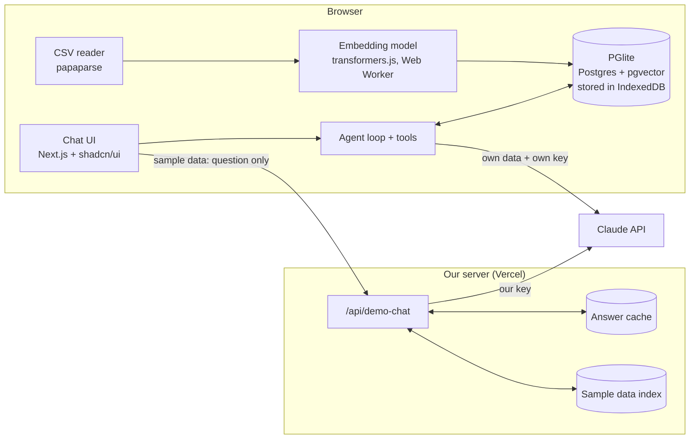

# Money Chat: the plan

Money Chat lets people ask questions about their bank statements in plain English. This page explains what we're building, in what order, and why.

## The big ideas

**Your data stays with you.** Statements are read and stored in your browser. Our server never sees them.

**RAG where it helps, plain math where it doesn't.** RAG means finding the right pieces of your data and handing them to the AI before it answers. We use it to:

1. **Find transactions** from a vague description ("that coffee place near work").
2. **Sort transactions into categories** by comparing them to ones already sorted. Fix one, and it learns.
3. **Read the fine print** ("why was I charged $35?") by finding both the fee and the rule that explains it.
4. **Turn vague questions into exact numbers** ("how much on coffee?"): RAG decides what counts as coffee, then plain math adds it up.

Totals and averages are always plain math, never the AI, so the numbers are exact.

## How people use it

- **Try it with sample data:** one year of made-up statements. No setup and nothing to paste. This runs on our Claude key, with the protections below.
- **Use your own statements:** bring your own Claude key. The key stays in memory only and is gone when you close the tab. We suggest making a separate key with a spending limit.

## Keeping our costs safe (sample data mode)

1. **Hard spending cap.** The demo uses its own Anthropic workspace with a monthly limit. If it's hit, the demo pauses. It never overspends.
2. **Demo questions only.** The browser sends just the question. Our server adds the sample data and fixed instructions, so nobody can use our key for anything else.
3. **Per-visitor limits.** A Vercel firewall rule limits how many questions one visitor can ask. Blocked requests never reach the app and aren't billed. (No separate daily total: that needs a database to count reliably, and the spending cap already covers it.)
4. **Small and cheap.** Claude Haiku 5.5, our smallest and cheapest model option, with short answers.
5. **Saved answers.**
   - *Suggested questions* (the clickable starters) are answered once by a script and saved in the project. Visitors get the saved answer, which costs nothing. We re-run the script only when the sample data, the agent or the questions change, not on every deploy. Saved answers carry a fingerprint, so stale ones are ignored automatically.
   - *Other questions* are saved after the first time anyone asks them, so asking again is free.

## Architecture

This section is more technical.

### Overview



### Where things run

| Piece | Runs in | Choice | Why |
|---|---|---|---|
| CSV reading | Browser | `papaparse` + our column matcher | Files never leave the device |
| Database | Browser | PGlite (Postgres compiled to WASM) with `pgvector` and `pg_textsearch` (BM25), saved in IndexedDB | Real SQL for exact math, vector search, and keyword search in one place. The same code runs in Node for the demo |
| Embeddings | Browser | `transformers.js` with `all-MiniLM-L6-v2` (384 dimensions), in a Web Worker | Anthropic has no embeddings API, and this keeps users to one key. About 23 MB, downloaded once and cached. Chosen over `bge-small` after comparing both on the sample data: its scores separate good and bad matches more clearly |
| AI answers | Claude API | User's key (their data), our key (demo) | Best answer quality, no model downloads |

### Data model

```sql
transactions (
  id, account, date, description, amount, category,
  merchant,              -- cleaned-up name, e.g. "Blue Bottle Coffee"
  embedding vector(384), -- meaning, for search by meaning
  search_text text       -- description + category; embedded and BM25-indexed
)

documents (              -- fine print, split into chunks
  id, source, chunk_text, embedding vector(384), search tsvector
)

merchant_labels (        -- examples used to label new transactions
  raw_description, merchant, category,
  source                 -- 'model' or 'user' (user corrections win)
)
```

**Chunking.** Each transaction is one chunk. Its search text is the description plus the bank's category (e.g. `WHOLEFDS BKN 10233 (Groceries)`), which helped a lot in testing. Identical texts are embedded once: the sample data's 663 transactions have only 45 unique texts. Fine print is split by section heading, with the heading kept on every chunk.

### Retrieval

Hybrid search, run inside Postgres:

1. **Filter first** on structured fields the model extracts from the question (date range, account, amount range).
2. **Two rankings** of what's left: vector similarity (`pgvector`, cosine, with a minimum similarity of 0.35) and keyword match (BM25 via `pg_textsearch`, with English stemming).
3. **Merge** with reciprocal rank fusion, then return the top k with their IDs so answers can cite them.

### The agent

Claude gets a small set of tools and decides which to call, possibly more than once:

| Tool | What it does | RAG? |
|---|---|---|
| `search_transactions(query, date_from?, date_to?, account?, min_amount?, max_amount?)` | Hybrid search over transactions | Yes |
| `search_fine_print(query)` | Hybrid search over statement documents | Yes |
| `sum_transactions(merchants? \| categories?, date_from?, date_to?, group_by?)` | Exact totals in SQL | No, plain math |

For "how much did I spend on coffee?", Claude calls `search_transactions("coffee")` to find which merchants count, then `sum_transactions(merchants=[...])` for the exact total. Answers must cite the transaction IDs or fine print chunks they used.

The agent loop and tools are one TypeScript module that takes a database connection. In the browser it gets the user's PGlite. On the server it gets the sample data index.

### The two modes

**Sample data (our key)**
1. The browser sends only `{ question }` (length-capped) to `/api/demo-chat`.
2. A Vercel WAF rule rate-limits `POST /api/demo-chat` per IP before the function runs.
3. It checks the answer cache:
   - *Suggested questions*: answers are generated by `npm run save-answers` and committed as `src/data/saved-answers.json`.
   - *Other first questions*: stored in Vercel's Runtime Cache for 30 days after the first ask. Follow-ups are never saved, since their answers depend on the conversation.
   - Both are keyed by a **fingerprint**: a hash of the sample data plus the agent's model, prompt, tools and settings. Change any of them and old answers stop matching on their own. Re-run `npm run save-answers` to refresh the suggested ones.
4. On a miss, it runs the agent against the sample data with Claude Haiku 5.5 (low effort, capped answer length), then saves the answer.
5. The backstop is a separate Anthropic workspace with a monthly spending limit.

The server loads the sample CSVs into an in-memory PGlite and embeds them on first use (45 unique texts, ~0.1 s once the model is loaded). It needs the embedding model anyway to embed Claude's search queries, so a pre-built index would add a step without saving much. The embedding runtime is a native Linux binary (~44 MB), listed explicitly in `next.config.ts` because the library loads it dynamically.

**Your own data (your key)**
- The agent loop runs in the browser and calls the Claude API directly with the user's key.
- The key is held in memory only: no `localStorage`, gone when the tab closes.
- Statement data goes only to Anthropic, as part of the question. Never to our server.

### Security

- **Content Security Policy.** `connect-src` allows only our own origin, `api.anthropic.com`, and the host serving the embedding model files. No third-party scripts or analytics on the page.
- **No server storage of user data.** Our only API route is the demo, and it never accepts transaction data.
- **Clear data.** One button deletes the PGlite database from the browser.

### Quality checks (evals)

`npm run eval` asks the real agent 26 questions about the sample data (`evals/demo-chat/cases.json`, readable in `CASES.md`) and grades every answer:

- **Plain code** checks the facts (patterns each answer must mention), that every `[T#]` citation is real, and that date/account questions only cite matching transactions.
- **A Claude Sonnet 5.5 judge** checks the rule-following: no totals yet, declines off-topic questions, doesn't invent things that aren't there, doesn't take back earlier answers.

It's built on Anthropic's eval runner (retries, per-question time limit, resume, and a fingerprint of the eval code that has to be approved before it runs). Results land in `.claude/hillclimb/demo-chat/`.

**Baseline:** 52/52 (26 questions × 2 runs), $0.07 per full run, median answer 2.9 s. A perfect score means it's a safety net for now, not a measuring tool: new steps add questions that fail until the feature works.

## Build order

Each step is its own pull request, and each one ends with something you can see working.

1. **Load the data.** "Try sample data" or upload CSVs, and see every transaction in a table. ✅
2. **Search by meaning.** Searching "coffee" finds Starbucks and Joe's Cafe, even though they never say "coffee". ✅
3. **Chat (sample data).** Ask a question, get an answer that points to the transactions it used. ✅
4. **Saved answers and limits.** Suggested questions, the answer cache, rate limits. ✅
5. **Quality checks (evals).** 26 questions with known answers, scored automatically on every change. Moved up from last, so every later step can show before/after scores. ✅
6. **Exact math.** "How much did I spend on coffee?" uses RAG to pick the merchants, then adds them up. Also sorting ("biggest purchase").
7. **Fine print.** "Why was I charged $35?" finds the fee and the rule.
8. **Bring your own key.** Use the app with your real statements.
9. **Store names and categories.** Clean up messy bank names (`SQ *BLUE BTL 0423` → Blue Bottle Coffee) so search finds them too, and learn from your corrections.

## What we're not doing

- No running AI models inside the browser. You bring a key, or use the demo.
- No accounts or logins.
- No PDF statements at first. CSV only; PDF may come later.
